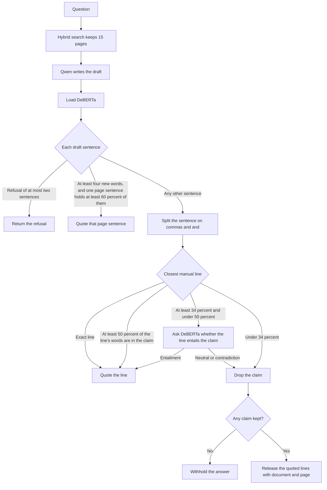

# torque-diagnostics
Technician assistant for ABB drive manuals. Answers from indexed pages and withholds a procedure the manual does not support.

## Python

Install [uv](https://docs.astral.sh/uv/), clone the repo, and from the repository root run:

```bash
uv sync
```

That creates `.venv` and installs boto3, DuckDB, Polars, PyArrow, PyMuPDF, Pillow, and pytesseract.

### After uv sync

Export a current AWS session in the same shell. The scripts do not contain access keys. The chunking script reads the text already stored in each PDF page. Drawing pages are not scanned.

```bash
export AWS_ACCESS_KEY_ID='...'
export AWS_SECRET_ACCESS_KEY='...'
export AWS_SESSION_TOKEN='...'
export AWS_DEFAULT_REGION=us-east-1
```

Then run from the repository root:

```bash
uv run python data-ingestion/scripts/upload_library_pdfs.py
uv run python data-preprocessing/chunk_raw_pdfs.py
```

The upload script reads `ABB_100GB_Download_List.csv` from the current directory or from the repository root. It stores each PDF at `raw/<equipment>/<document-kind>/<document_id>.pdf`. The equipment folder is the ACS880 frame, a firmware manual, or another series named in the title, such as COM600 or REC615. Catalogues, articles, brochures, and technical files with no series in the title stay in `library`. A PDF already at that key is skipped, so running the script again does not download it a second time.

The chunking script reads those raw keys and writes Parquet under `chunks/asset_family=<family>/<document_id>.parquet`, using the equipment folder as the family. A shard is skipped only when its Parquet footer is intact. At the start of a run it rewrites `chunk_remaining.txt` from the raw keys that still have no finished shard, and writes the counts to `chunk_status.txt`. A key that is no longer in the bucket is left off that list. Set `MAX_FILES` to convert one batch and then stop. `MAX_FILES=100` is a safe batch on the project EC2. Leave it unset to process every remaining PDF.

```bash
MAX_FILES=100 uv run python data-preprocessing/chunk_raw_pdfs.py
```

Progress is written to `chunk_status.txt` in the working directory. Keys that still need a shard are listed in `chunk_remaining.txt`. Failures are appended to `chunk_failed.txt`. Run only one copy of the chunking script at a time. Files of 200 MB or more run alone. Smaller files run two at a time.

After chunking has finished, DuckDB reads the passage Parquet and writes a coverage count per equipment folder to `coverage.txt`. The report counts shards and rows, including a file that stored no rows, and still counts tracing pages, fault codes, parts, and procedures. It is not used to answer a technician question.

```bash
uv run python data-preprocessing/coverage_duckdb.py
```

The indexing step tokenizes the passage rows for that family. It does not embed them yet. A finished token file is skipped unless `REBUILD=1`. Tokenizers live in `data-indexing/tokenization`. The identifier tokenizer keeps a frame, firmware name, fault code, parameter, and document id whole. The same longest match covers every drive family, so ACS580-01 reads the ACS580 folder and ACS880-04 reads the ACS880-04 folder. A drive or product whose manuals stayed in library, such as ACH550 or IRC5, reads library. The BM25 tokenizer lowercases, keeps a hyphenated token and its pieces, and does not stem. Run one equipment folder first.

```bash
uv run python data-indexing/tokenization/manual_tokens.py
INDEX_FAMILY=ACS880-11 uv run python data-indexing/tokenization/build_tokens.py
```

The word index is BM25 over those tokens, one file per equipment folder, so a rebuilt token file has to be followed by a rebuilt BM25 file. `data-indexing/bm25` builds that index. `data-indexing/query` tokenizes a question the same way and returns the highest-scoring passages with the document id and page. This does not write the technician's answer.

```bash
INDEX_FAMILY=ACS880-11 uv run python data-indexing/bm25/build_bm25.py
QUESTION='necessary tools for flange mounting ACS880-11' uv run python data-indexing/query/query_bm25.py
```

The embedding index uses one English sentence-transformer, `BAAI/bge-base-en-v1.5`, on the same passage text. One file is written per equipment folder. A finished embedding file is skipped unless `REBUILD=1`. A question is embedded with that model's retrieval prefix. `query_hybrid.py` scales the BM25 score and the embedding score to the same range and adds them. This does not write the technician's answer.

```bash
INDEX_FAMILY=ACS880-11 uv run python data-indexing/embeddings/build_embeddings.py
QUESTION='socket set and hex key set for flange-mounting ACS880-11' uv run python data-indexing/query/query_hybrid.py
```

The reply reads the top 15 merged passage rows. `Qwen/Qwen2.5-7B-Instruct` writes the draft from those rows and does not name a document or a page. The code then attaches the citation. `MoritzLaurer/DeBERTa-v3-base-mnli-fever-anli` is loaded on every reply. Its entailment judgment runs for one case: the claim is not already a sentence on a retrieved page, it is not an exact line, and the closest line shares at least 34 percent of its content words and under 50 percent. Entailment keeps that line. Neutral or contradiction drops it. If no claim remains, the answer is withheld.



```bash
QUESTION='What tools are needed to flange-mount an ACS880-11?' \\
  INDEX_FAMILY=ACS880-11 uv run python reply/answer_question.py
```
