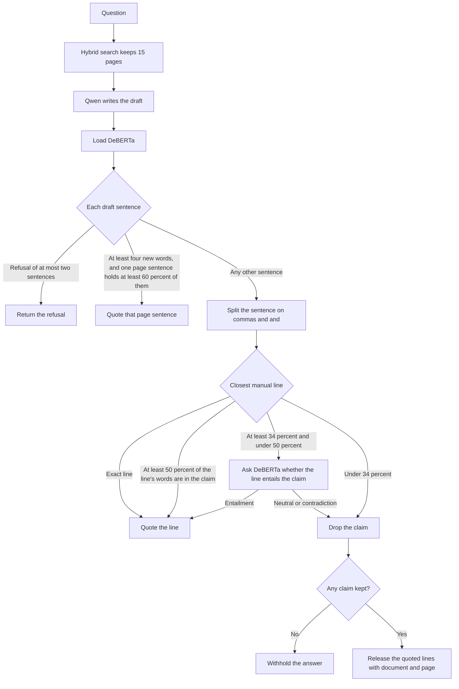

# Torque Diagnostics: full run from a new EC2

Run these steps in order, from the repository root, in one shell. Each command covers the whole collection. A file already stored in S3 is skipped, so stopping and starting the same command again continues the remaining work.

The list is `ABB_100GB_Download_List.csv`: 28,666 English PDFs, 101.84 GB, placed into 139 equipment folders (`library` plus 138 named series).

## 1. Launch the instance

Use region `us-east-1`.

| Setting | Value |
|---|---|
| Instance type | `g5.xlarge` (one A10G, 24 GB GPU memory, 16 GB RAM) |
| AMI | Current Deep Learning Base GPU AMI for Ubuntu, so `nvidia-smi` works |
| Security group | `DataScience-NaturalLanguageProcessing-SG` |
| Root disk | 150 GB |
| Key pair | The course key already used for this project |

Port 22 on that security group accepts connections from the GWU networks `128.164.0.0/16` and `161.253.0.0/16`. Connect from campus or the GWU VPN.

The GPU is required for the embedding index and for the answer. The PDF download and the passage chunking do not use the GPU.

## 2. Connect

The public DNS changes after every stop and start. Copy the current value from the EC2 console.

```bash
chmod 600 /Users/dhanushmathivanan/dhanush_gwu/aws_config_keys/AWS_NLP_Config_keys.pem
ssh -i /Users/dhanushmathivanan/dhanush_gwu/aws_config_keys/AWS_NLP_Config_keys.pem ubuntu@THE_PUBLIC_DNS
```

Long jobs should run inside `tmux`, so a dropped SSH session does not kill them:

```bash
sudo apt-get update && sudo apt-get install -y tmux
tmux new -s torque
```

Detach with `Ctrl-b` then `d`. Reattach with `tmux attach -t torque`.

## 3. Install every Python library

`pyproject.toml` is the dependency list, the same role as `package.json`. `uv.lock` pins the exact versions, the same role as `package-lock.json`. `uv sync` reads both files and installs that set into `.venv`. There is no separate install for each library. Later commands use `uv run`, which uses that environment.

```bash
curl -LsSf https://astral.sh/uv/install.sh | sh
source "$HOME/.local/bin/env"
git clone https://github.com/DhanushGWU1995/torque-diagnostics.git
cd torque-diagnostics
uv sync
```

The repository is private. Log in with a GitHub account that can read it. Run `uv sync` once, from the repository root, before any project script. Every later command in this document is run from this directory.

`uv sync` installs the libraries named in `pyproject.toml`:

| Library | Used for |
|---|---|
| `boto3` | Reading and writing the S3 bucket |
| `duckdb` | Coverage counts, and reading Parquet while the indexes are built |
| `polars` | Writing each passage Parquet file |
| `pyarrow` | Writing the token and embedding Parquet files |
| `pymupdf` | Reading the text layer of each PDF during chunking |
| `numpy` | Embedding vectors |
| `rank-bm25` | The BM25 index |
| `sentence-transformers` | `BAAI/bge-base-en-v1.5` for the embedding index and for a question |
| `torch` | GPU execution for the embedding model, Qwen, and DeBERTa |
| `transformers` | `Qwen/Qwen2.5-7B-Instruct` and `MoritzLaurer/DeBERTa-v3-base-mnli-fever-anli` |
| `accelerate` | Loading the Qwen weights onto the GPU |
| `pillow` | Image handling used by the model libraries |
| `pytesseract` | Present in the project file. This full run reads the PDF text layer and does not call it |

On Linux, the locked PyTorch build includes the CUDA libraries. The model weights themselves (`bge`, Qwen, and DeBERTa) download on the first embedding run and the first answer, after this install.

Check the GPU:

```bash
nvidia-smi
uv run python -c "import torch; print(torch.cuda.is_available(), torch.cuda.get_device_name(0))"
```

The print has to be `True` and the A10G name before the embedding step.

Check the folder router. This does not use AWS:

```bash
uv run python data-indexing/tokenization/manual_tokens.py
```

## 4. AWS session

Export a current temporary key, secret, and session token from the course console. Do this inside the `tmux` session. The scripts read these variables and do not store keys.

```bash
export AWS_ACCESS_KEY_ID="..."
export AWS_SECRET_ACCESS_KEY="..."
export AWS_SESSION_TOKEN="..."
export AWS_DEFAULT_REGION=us-east-1
```

The session expires. If a script prints `ExpiredToken`, export a new set in the same shell and run that script again. Finished S3 objects stay in place.

Confirm the account can see the bucket:

```bash
uv run python -c "import boto3; c=boto3.client('s3', region_name='us-east-1'); print(c.list_objects_v2(Bucket='dats-nlp', Prefix='dhanush.mathivanan@gwu.edu/torque-diagnostics/', MaxKeys=1).get('KeyCount'))"
```

`1` means the prefix is visible.

## 5. Download every PDF into S3

`data-ingestion/scripts/upload_library_pdfs.py` reads `ABB_100GB_Download_List.csv` from the repository root. It downloads each PDF from the URL in that file and stores it at:

```text
s3://dats-nlp/dhanush.mathivanan@gwu.edu/torque-diagnostics/raw/<family>/<document-kind>/<document_id>.pdf
```

The family comes from the title. An ACS880 frame stays in its own folder. Another named series gets its own folder. Catalogues, articles, brochures, and technical files with no series stay in `library`. Four downloads run at a time. A key that is already in the bucket is skipped. The PDF is streamed to S3, so the instance does not keep the 101.84 GB locally.

```bash
uv run python data-ingestion/scripts/upload_library_pdfs.py
```

Wait until the log says `done`. A failed row is appended to `library_upload_failed.txt`, and the folder markers are written only after every row has succeeded. Run the same command again to retry the failures. The stored PDFs are skipped.

When the run succeeds, each raw folder receives a `_COMPLETE` marker listing the keys in that folder.

## 6. Chunk every PDF into passage Parquet

`data-preprocessing/chunk_raw_pdfs.py` reads those raw PDFs and writes one Parquet file per PDF:

```text
s3://dats-nlp/dhanush.mathivanan@gwu.edu/torque-diagnostics/chunks/asset_family=<family>/<document_id>.parquet
```

Each passage stays on one page. A page longer than 3,500 characters is split, and the pieces keep that page number. The text is the PDF text layer. Drawing pages are not sent to Tesseract. Files of 200 MB or more run one at a time. Smaller files run two at a time. `library` is queued after the named folders.

Leave `MAX_FILES` unset. That processes every PDF that does not already have a finished Parquet footer.

```bash
uv run python data-preprocessing/chunk_raw_pdfs.py
```

Progress is rewritten to `chunk_status.txt`. The PDFs that still need a shard are listed in `chunk_remaining.txt`. Failures are appended to `chunk_failed.txt`. The temporary PDF is deleted after each file. If the session stops, run the same command again. A shard with an intact Parquet footer is skipped.

The finished text pass stored 28,665 passage files and 831,185 passages. `chunk_status.txt` should show `remaining=0` and `failed=0` before the next step.

## 7. Coverage report

`data-preprocessing/coverage_duckdb.py` counts shards, passages, blank passages, tracing pages, fault codes, parts, and procedures for every folder. It writes `coverage.txt`. It does not build an index and it does not answer a question. Run it once, after chunking has finished.

```bash
uv run python data-preprocessing/coverage_duckdb.py
```

## 8. Tokenize every folder

`data-indexing/tokenization/build_tokens.py` reads the passage Parquet and writes one token file per folder:

```text
s3://dats-nlp/dhanush.mathivanan@gwu.edu/torque-diagnostics/index/tokens/asset_family=<family>.parquet
```

`INDEX_FAMILY=all` selects every folder that has passage files. Named folders use one process. `library` uses three processes. A finished token file is skipped. Leave `REBUILD` unset.

```bash
INDEX_FAMILY=all uv run python data-indexing/tokenization/build_tokens.py
```

The summary is written to `token_status.txt`. `stored` counts folders written on this run. Folders that print `skip` were already finished.

## 9. Build the BM25 index for every folder

`data-indexing/bm25/build_bm25.py` reads the token files from step 8. Run it after tokenization. It writes:

```text
s3://dats-nlp/dhanush.mathivanan@gwu.edu/torque-diagnostics/index/bm25/asset_family=<family>.pkl
```

```bash
INDEX_FAMILY=all uv run python data-indexing/bm25/build_bm25.py
```

The summary is written to `bm25_status.txt`. A finished index prints `skip`.

## 10. Build the embedding index for every folder

`data-indexing/embeddings/build_embeddings.py` reads the same passage text and embeds it with `BAAI/bge-base-en-v1.5`. The first run downloads that model. The log line has to say `device=cuda`. It writes:

```text
s3://dats-nlp/dhanush.mathivanan@gwu.edu/torque-diagnostics/index/embeddings/asset_family=<family>.parquet
```

`library` is last and is most of the passages, so this is the long GPU job. Run it alone. Do not start the answer while it is running.

```bash
INDEX_FAMILY=all uv run python data-indexing/embeddings/build_embeddings.py
```

The summary is written to `embeddings_status.txt`. A finished index prints `skip`.

At this point every folder has a token file, a BM25 index, and an embedding index. Steps 5 through 10 are done.

## 11. Ask a question

`reply/answer_question.py` does not take a folder name. The words in the question choose the folder. A question that names no series reads `library`. Leave `INDEX_FAMILY` unset.

The reply retrieves the top 15 passages from the BM25 index and the embedding index for that folder, scales the two scores to the same range, and adds them. `Qwen/Qwen2.5-7B-Instruct` writes the draft and does not name a document or a page. The program attaches the citation. `MoritzLaurer/DeBERTa-v3-base-mnli-fever-anli` is loaded on every reply. It judges a sentence only when that sentence is a partial paraphrase of a retrieved line. A sentence already on the page is quoted. A sentence the pages do not support is dropped. If nothing remains, the answer is withheld.



The first reply downloads Qwen and DeBERTa.

```bash
QUESTION='What tools are needed to flange-mount an ACS880-11?' \
  uv run python reply/answer_question.py
```

```bash
QUESTION='Which faults can the ACS860 reset automatically?' \
  uv run python reply/answer_question.py
```

Any other technician question uses the same command. Change only `QUESTION`.

The log prints `folders:`, then `writer=Qwen/Qwen2.5-7B-Instruct`, then `checker=MoritzLaurer/DeBERTa-v3-base-mnli-fever-anli`, then the answer. Each kept sentence ends with the document id and page.

## 12. Validate the cited pages

`reply/evaluate_answers.py` reads `reply/questions.jsonl`. Each line is one question plus the document pages that support it. `ANSWER=1` is required. The script runs the same reply as step 11 for every line, scores the pages cited in the answer, and writes `evaluation_report.txt` in the repository root.

```bash
ANSWER=1 uv run python reply/evaluate_answers.py
```

A cited page is correct when its document id and page number are in that question's `relevant` list. Precision is the share of cited pages that are correct. Recall is the share of correct pages the answer cites. F1 is their harmonic mean. MRR is 1 divided by the position of the first correct citation. The confidence value on the same row is `copied-sentence`, `deberta`, or `withheld`, followed by `deberta_calls`. The `macro` row is the average across the questions in the file.

The file starts with two questions:

- Flange-mount tools for an ACS880-11, checked page `3AXD50000349838` page 17.
- ACS860 automatic reset, checked pages `3AXD50000034052` page 68 and `3ABD00069490` page 27.

Add a new hand-checked question as one more JSON line in `reply/questions.jsonl`, then run the same command. The indexes are not rebuilt.

## Rules for the whole run

- Run one of these scripts at a time.
- Keep the AWS variables exported in that shell.
- Leave `REBUILD` unset. `REBUILD=1` rewrites a finished token, BM25, or embedding file.
- Leave `MAX_FILES` unset for the full chunking pass.
- Use `INDEX_FAMILY=all` for tokens, BM25, and embeddings. Leave `INDEX_FAMILY` unset for a question, a search, and validation.
- The indexed text is the PDF text layer. This run does not extract ruled tables or figure text.
